# Code Tour

This guide follows the code added or substantially updated for this project. The
original starter interface and much of `app.js` came from the fork; the notes
below point to the project-specific pieces so you can read them in context.

## Two separate flows

The Python scripts prepare the search data once. The browser and Edge Functions
use that prepared data when someone searches.

```mermaid
flowchart LR
  subgraph Import[Prepare data]
    Talks[Talk pages] --> Scrape[02 scrape]
    Scrape --> Split[03 split into sentences]
    Split --> Embed[04 create vectors]
    Embed --> Upload[05 upload vectors]
    Upload --> DB[(Supabase sentence_embeddings)]
  end

  subgraph Search[Answer a question]
    User[Question in browser] --> EmbedQ[embed-question Edge Function]
    EmbedQ --> OpenAIEmbed[OpenAI embedding API]
    OpenAIEmbed --> Match[match_sentences database function]
    DB --> Match
    Match --> Talks2[Group results into talks]
    Talks2 --> Answer[generate-answer Edge Function]
    Answer --> OpenAIChat[OpenAI answer API]
    OpenAIChat --> User
  end
```

## Read the data pipeline

1. [`scripts/01_create_schema.py`](scripts/01_create_schema.py) applies the SQL
   migration and checks that Supabase can see the new tables and functions.
2. [`scripts/02_scrape_data.py`](scripts/02_scrape_data.py) downloads talk pages
   and writes structured talk records to `scripts/output/talks.json`.
3. [`scripts/03_import_data.py`](scripts/03_import_data.py) gives each talk a
   stable ID, splits its text into numbered sentences, and imports text-only
   rows. The stable `(talk_id, sentence_num)` pair lets later runs update the
   same sentence instead of creating a duplicate.
4. [`scripts/04_embed_data.py`](scripts/04_embed_data.py) sends sentence text to
   OpenAI and saves each returned vector in a local checkpoint. The checkpoint
   is keyed by that same stable sentence ID, which makes retries skip completed
   work.
5. [`scripts/05_update_embeddings.py`](scripts/05_update_embeddings.py) adds
   those vectors to the matching Supabase rows and verifies the row counts.

The distinction between stages 3 and 5 is useful: keyword search needs only the
sentence text; semantic search also needs the vector.

## Trace a live question

Start at `askQuestion()` in [`app.js`](app.js#L570), then follow these calls:

1. `getEmbedding()` calls the `embed-question` Edge Function.
2. `searchSentences()` calls Supabase's `match_sentences()` function.
3. `groupByTalk()` combines the best sentence matches by talk.
4. `fetchFullTalkText()` retrieves more context for those talks.
5. `generateAnswer()` sends the question and source talks to the
   `generate-answer` Edge Function.

The SQL search function is in
[`supabase/migrations/20261021220000_initial_schema.sql`](supabase/migrations/20261021220000_initial_schema.sql#L67).
It compares vectors with cosine distance, then returns a similarity score for
display in the app.

## Project-specific browser changes

- The shared speaker selector is in [`index.html`](index.html#L88). Its values
  come from `list_speakers()` through `loadSpeakerOptions()` in `app.js`.
- `keywordSearch()`, `semanticSearch()`, and `askQuestion()` apply the selected
  speaker to their searches.
- Readiness checks send `{ health_check: true }` to the Edge Functions. The
  functions return before calling OpenAI, so refreshing the page does not spend
  tokens.
- `safeHref()` only allows HTTPS talk links. The Edge Function response checks
  reject malformed embeddings or empty generated answers before the UI uses
  them.

## Follow the security boundary

- [`supabase/functions/_shared/auth.ts`](supabase/functions/_shared/auth.ts)
  verifies a bearer token with Supabase Auth and returns the authenticated user
  ID.
- [`supabase/functions/_shared/cors.ts`](supabase/functions/_shared/cors.ts)
  sets browser CORS headers for the deployed site and local development.
- `embed-question` checks authentication and validates a question before
  calling the embeddings API.
- `generate-answer` checks authentication, limits the question and source
  context, then asks the model to answer from those sources.
- The migration enables row-level security and allows signed-in users to read
  talk sentences. Local scripts read credentials from the git-ignored config
  file; the browser loads only the Supabase publishable key. The OpenAI key is
  also saved as a Supabase secret for the hosted Edge Functions.

## Terms used in the code

- **Sentence row:** One numbered sentence from a talk, plus its talk metadata.
- **Embedding:** A 1,536-number representation of text that makes meaning-based
  comparison possible.
- **Vector search:** Finding stored embeddings closest to a question embedding.
- **RPC:** A database function the app calls by name, such as `match_sentences`.
- **Edge Function:** A small server-side endpoint; here it holds the OpenAI key
  and makes requests to OpenAI.
- **RLS:** Row-level security; PostgreSQL applies access rules to each table row.
